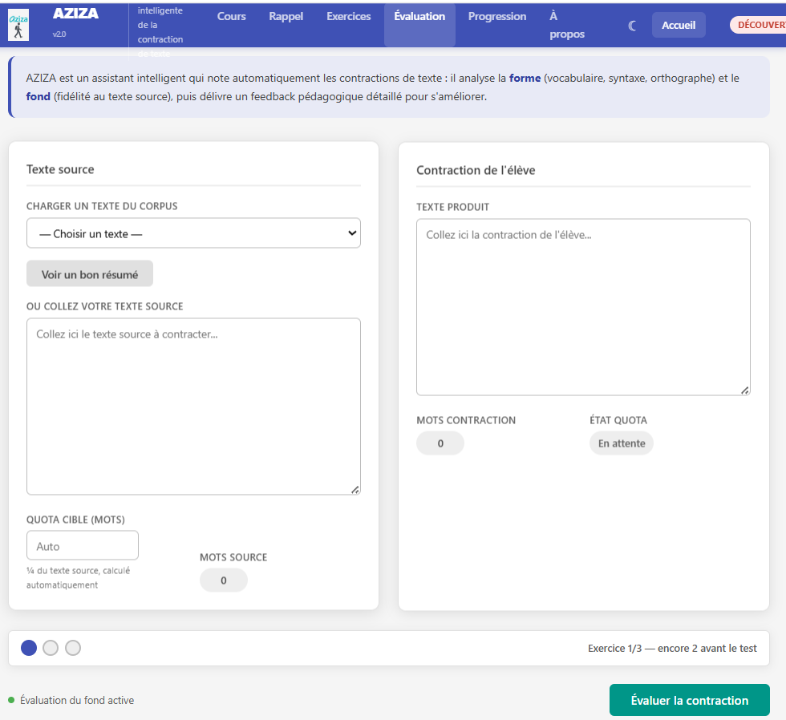
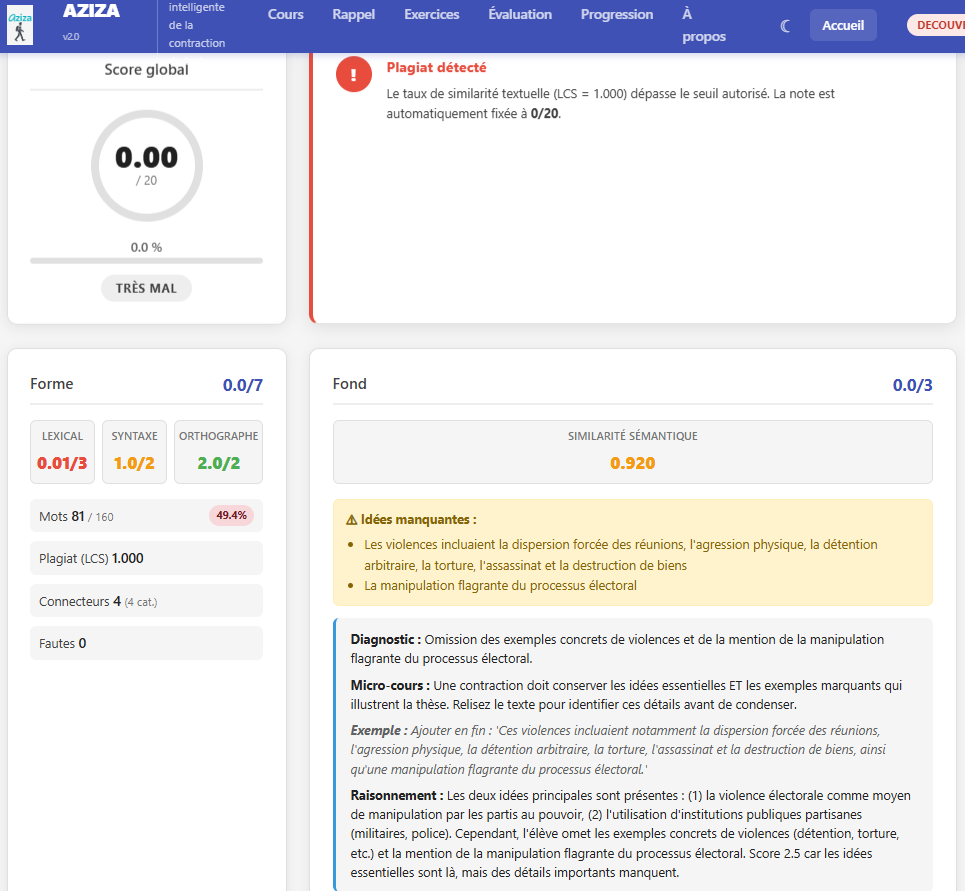

# AZIZA — Assistant Intelligent pour la Contraction de Texte au BAC Béninois

[](https://github.com/Shado-Jony/Aziza_contraction_de_texte)
[]()
[](https://Jiovany11.pythonanywhere.com)

**Version 2.0** — Pipeline NLP hybride d'évaluation automatique avec correction forme/fond, verrous pédagogiques, et interface web Flask.

AZIZA (Zone d'Apprentissage et l'Excellence Académique) est un moteur IA conçu pour noter automatiquement les épreuves de contraction de texte du Baccalauréat béninois. Il combine des métriques lexicales classiques, une analyse linguistique outillée (LanguageTool), et un LLM (Mistral AI) pour une évaluation en deux axes : **Forme (/7)** et **Fond (/3)**, fusionnés en une note finale **/10**.

---

## Architecture du scoring

```
                    ┌─────────────────────────┐
                    │     Note finale /10      │
                    └──────────┬───────────────┘
                               │
              ┌────────────────┼────────────────┐
              │                                   │
         Forme /7                              Fond /3
     (métriques fermées)                   (LLM Mistral)
              │                                   │
    ┌─────────┼──────────┐           ┌────────────┼────────────┐
    │         │          │           │            │            │
  Lexical   Syntaxe  Orthographe   Sémantique   LLM Few-Shot   Calibration
    /3        /2        /2        (embedding)  (CoT + 5 ex.)  + Subjectivité
```

### Forme (/7) — Métriques déterministes

| Composante | Note | Méthode |
|------------|------|---------|
| **Lexical** | /3 | LCS normalisé + fonction parabolique (Smin=0.26, Smax=0.80) + pénalité quota continue `min(2, ecart_pct/50)` |
| **Syntaxe** | /2 | Ratio de phrases (src/ctr) + connecteurs logiques (9 catégories) |
| **Orthographe** | /2 | LanguageTool API distant + barème dégressif × `min(1, nb_mots/30)` + affichage détaillé des erreurs |

### Fond (/3) — Évaluation LLM

| Composante | Note | Méthode |
|------------|------|---------|
| **Similarité sémantique** | — | `mistral-embed`, seuil hors-sujet < 0.85 |
| **Raisonnement & contresens** | /3 | `mistral-small-latest`, prompt Few-Shot + CoT + 5 exemples, format `content` en tableau de parties |
| **Subjectivité** | −1pt | Détection des pronoms personnels (je, moi, mon…) et expressions d'opinion (à mon avis, selon moi, je pense…) |

### Verrous pédagogiques

| Verrou | Déclencheur | Effet |
|--------|-------------|-------|
| **Plagiat** | LCS ≥ 0.80 | Note globale = **0/10** |
| **Hors-sujet** | Sémantique < 0.85 | Fond = 0/3, pénalité Forme -1pt |
| **Texte trop court** | `nb_mots < 20` | Note globale = **0/10** |
| **Subjectivité** | Phrase avec opinion personnelle (je, à mon avis…) | Fond −1pt |

---

## Démarrage rapide

```bash
git clone https://github.com/Shado-Jony/Aziza_contraction_de_texte.git
cd Aziza_contraction_de_texte

# 1. Installer les dépendances
pip install -r requirements.txt

# 2. Configurer la clé API
cp .env.example .env
# Éditer .env et y mettre votre clé Mistral (voir https://console.mistral.ai/)

# 3. Lancer l'application
python demo/app.py
# → http://127.0.0.1:5100
```

### Documentation API (Swagger)

Une fois l'application lancée :

```
http://localhost:5100/apidocs
```

Interface Swagger UI interactive — 8 endpoints documentés :

| Endpoint | Méthode | Auth | Description |
|----------|---------|------|-------------|
| `/` | GET | — | Redirection vers le formulaire |
| `/soumission` | GET | — | Formulaire HTML d'évaluation |
| `/evaluer` | POST | — | Pipeline complet (formulaire HTML) |
| `/resultats/<session_id>` | GET | — | Page de résultats détaillés |
| `/progression` | GET | — | Tableau de bord et historique |
| `/demarrer` | POST | — | Initialisation session élève |
| **`/api/v1/health`** | GET | — | Healthcheck public |
| **`/api/v1/evaluer`** | POST | `X-API-Key` | API REST — évaluation JSON (60 req/min) |

---

## API REST

L'API REST expose les endpoints suivants (avec Swagger sur `/apidocs`) :

### POST /api/v1/evaluer

Évalue une contraction via JSON — nécessite une clé API dans le header `X-API-Key`.

```bash
curl -X POST http://localhost:5100/api/v1/evaluer \
  -H "Content-Type: application/json" \
  -H "X-API-Key: aziza-api-key-2026" \
  -d '{"texte_source": "Texte à contracter.", "contraction": "Texte produit."}'
```

Sous **Windows PowerShell** utiliser `curl.exe` :
```powershell
curl.exe -X POST http://localhost:5100/api/v1/evaluer -H "Content-Type: application/json" -H "X-API-Key: aziza-api-key-2026" -d '{\"texte_source\": \"Texte.\", \"contraction\": \"Ma contraction.\"}'
```

Ou en Python :
```bash
python -c "import requests; r=requests.post('http://localhost:5100/api/v1/evaluer', headers={'X-API-Key': 'aziza-api-key-2026'}, json={'texte_source': 'Texte.', 'contraction': 'Ma contraction.'}); print(r.json())"
```

**Réponse (200) :**
```json
{"succes": true, "note_finale": 4.33, "score_forme": 1.83, "score_fond": 2.5, ...}
```

**Rate limiting :** 60 requêtes/min. Header `X-API-Key` obligatoire.

### GET /api/v1/health

```bash
curl http://localhost:5100/api/v1/health
# → {"status": "ok", "version": "2.0.0"}
```

---

## Tests

```bash
# Tests unitaires rapides (117 tests, sans API externe)
python -m unittest tests.py

# Tests d'intégration (inclut appels réels API Mistral)
python tests.py all
```

Les tests sont automatisés via **GitHub Actions** sur chaque push (`.github/workflows/ci.yml`).

---

## Déploiement

L'application est déployée sur **PythonAnywhere** (gratuit) :

```bash
https://Jiovany11.pythonanywhere.com
```

### Procédure (si vous voulez déployer votre propre instance)

1. Créez un compte sur [pythonanywhere.com](https://www.pythonanywhere.com)
2. Ouvrez une console Bash et clonez :
   ```bash
   git clone https://github.com/Shado-Jony/Aziza_contraction_de_texte.git
   ```
3. Créez le virtualenv :
   ```bash
   mkvirtualenv aziza --python=3.12
   pip install -r Aziza_contraction_de_texte/requirements.txt
   ```
4. **Web → Add a new web app → Manual configuration → Python 3.12**
5. Configurez :
   - **WSGI file** : pointez vers `/home/votrepseudo/Aziza_contraction_de_texte/demo/app:app`
   - **Virtualenv** : `/home/votrepseudo/.virtualenvs/aziza`
   - **Static files** : `/static/` → `/home/votrepseudo/Aziza_contraction_de_texte/demo/static/`
   - **Environment variables** : `MISTRAL_API_KEY`, `AZIZA_API_KEY`, `FLASK_SECRET_KEY`
6. **Reload** → votre app est en ligne

### Mise à jour

```bash
cd ~/Aziza_contraction_de_texte && git pull
```
Puis **Reload** dans l'onglet Web.

---

## Structure du projet

```
Aziza_contraction_de_texte/
├── aziza/                           # Moteur IA
│   ├── __init__.py                  # v2.0.0
│   ├── pipeline/                    # Pipeline d'évaluation
│   │   ├── complet.py               # Orchestrateur : fusion forme + fond + verrous
│   │   ├── forme.py                 # Évaluation de la forme (/7)
│   │   ├── fond.py                  # Évaluation du fond (/3) via Mistral
│   │   ├── similarite.py            # Métriques lexicales (LCS, Jaccard, TF-IDF, parabole)
│   │   └── seuils_production.json   # Seuils v2.0
│   └── machine_etats.py             # Machine à états adaptative (3 paliers)
│
├── demo/                            # Interface web Flask
│   ├── app.py                       # Routes HTML + Swagger + rate limiting
│   ├── api.py                       # API REST (/api/v1/evaluer, /health) + auth
│   ├── static/
│   │   └── style.css                # Styles professionnels
│   ├── templates/
│   │   ├── soumission.html          # Formulaire d'évaluation
│   │   ├── resultats.html           # Résultats avec breakdown forme/fond
│   │   ├── progression.html         # Historique, graphiques Chart.js, radar
│   │   └── fiche_note.html          # Fiche imprimable/PDF
│   └── data/                        # Stockage automatique
│       ├── historique.json          # Historique des évaluations
│       └── productions/             # Textes sources + contractions bruts
│
├── .github/workflows/
│   └── ci.yml                       # CI : tests unitaires + intégration
│
├── .env.example                     # Variables d'environnement (template)
├── .gitignore
├── requirements.txt                 # Dépendances Python
├── tests.py                         # 117 tests unitaires + intégration + API REST
└── README.md                        # Ce fichier
```

---

## Configuration

Clé API Mistral déjà intégrée dans `aziza/pipeline/fond.py`. Pour la surcharger via l'environnement, copier `.env.example` vers `.env` :

```ini
MISTRAL_API_KEY=votre_cle_api_mistral    # Remplace la clé hardcodée
AZIZA_API_KEY=aziza-api-key-2026         # Clé pour l'API REST /api/v1/evaluer
FLASK_SECRET_KEY=une_cle_secrete_unique   # Changez en production
FLASK_ENV=production                      # development / production
FLASK_PORT=5100                           # Port d'écoute
```

---

## Graphiques de progression

La page `/progression` affiche (via Chart.js) :
- **3 courbes d'évolution** : Note globale /10, Forme /7, Fond /3
- **Radar des compétences** : Lexical, Syntaxe, Orthographe, Sémantique, Connecteurs

---
---

## Captures d'écran

| Page d'évaluation | Page de résultats |
|---|---|
|  |  |

---

## Expérimentation et validation

6 notebooks d'expérimentation ont été réalisés sur un corpus réel :

| Expérience | Composante | Métrique clé | Résultat |
|------------|-----------|--------------|----------|
| EDA | Corpus | Statistiques descriptives | — |
| Forme 1 | Lexical | Smin=0.26, Smax=0.80 | Fonction parabolique validée |
| Forme 2 | Syntaxe + Ortho | LanguageTool, connecteurs | Barème dégressif |
| Forme 3 | Fusion Forme /7 | Pearson r=0.636 | Corrélation modérée |
| Fond 1 | Embeddings Mistral | Smin_sem=0.85 | Seuil hors-sujet |
| Fond 2 | LLM Few-Shot /3 | Pearson r=0.860, F1 contresens=0.77 | Très forte corrélation |
| Globale | Fusion /10 | **Pearson r=0.797**, **Weighted Kappa=0.776** | Accord substantiel |

Rapport de synthèse : `experiments/resultats/forme_et_fond/rapport_synthese.md`

---

## Stack technique

| Technologie | Usage |
|-------------|-------|
| **Python 3.12+** | Langage hôte |
| **Flask** | Interface web |
| **Mistral AI API** | Embeddings (`mistral-embed`) + LLM (`mistral-small-latest`) |
| **LanguageTool** | Correction orthographique distante |
| **scikit-learn** | TF-IDF, similarité cosinus |
| **flasgger** | Documentation Swagger/OpenAPI |
| **flask-limiter** | Rate limiting API REST (60 req/min) |
| **Chart.js** | Graphiques de progression (CDN) |
| **GitHub Actions** | CI/CD (optionnel) |
| **PythonAnywhere** | Hébergement gratuit |

---

## Licence

Projet académique — utilisation dans le cadre de l'évaluation de la Contraction de texte au Baccalauréat béninois.
